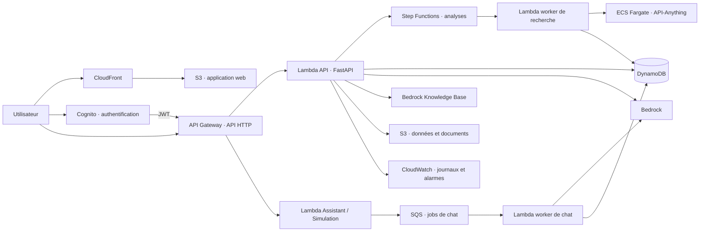

# InvestorOS

InvestorOS est une plateforme d’aide à la décision d’investissement créée pour le Datathon Polyfinance 2026. Elle permet d’explorer des profils et portefeuilles fictifs, de comparer des actifs, d’examiner des risques et de construire des scénarios conditionnels. Les analyses distinguent les données, les hypothèses et leurs limites. La plateforme n’exécute aucune transaction et ne fournit pas de conseil financier personnalisé.

## Lancer le projet en local

Prérequis : Node.js 24, npm, Python 3.12 et `uv`.

À la racine du dépôt :

```bash
npm ci
npm run dev:local
```

Cette commande démarre le frontend et l’API locale. Ouvrir l’URL affichée par Vite dans le terminal. Pour lancer seulement le frontend : `npm run dev:web`.

## Préparer et appliquer Terraform

Les stacks sont séparées. Pour la stack Assistant/Simulation :

```bash
# Avec un profil AWS SSO déjà configuré pour le compte de développement
export AWS_PROFILE=mon-profil-sso
aws sso login --profile "$AWS_PROFILE"

# Depuis la racine du dépôt
uv python install 3.12
./scripts/build-api.sh
cd infrastructure/terraform/environments/assistant-simulation
terraform init -reconfigure
terraform workspace show
terraform plan -out=/tmp/investoros-assistant-simulation.tfplan
terraform show /tmp/investoros-assistant-simulation.tfplan
```

Terraform requiert une session AWS autorisée dans le compte et la région attendus (`us-east-1`), ainsi que l’accès au backend S3 de cette stack. Après avoir vérifié que le plan ne supprime, ne remplace ni ne modifie de ressources hors du périmètre prévu, appliquer le plan examiné :

```bash
terraform apply /tmp/investoros-assistant-simulation.tfplan
```

`plan` ne modifie pas les ressources AWS; `apply` les modifie et peut entraîner des frais. Pour les prérequis, l’état connu et les limites de chaque stack, consulter son README avant toute application : [Assistant/Simulation](infrastructure/terraform/environments/assistant-simulation/README.md) et [dev](infrastructure/terraform/environments/dev/README.md). Ne pas appliquer une stack uniquement parce que son code Terraform existe.

`scripts/build-api.sh` a aussi besoin des fichiers `assets_universe.csv`, `prices_daily.csv` et `corporate_actions.csv` dans `docs/prep/sources/Datathon2026/alphaforge_starter/`. Ces données du datathon sont locales et ne sont pas incluses dans Git; le script s’arrête si elles sont absentes. Configurez `AWS_PROFILE` avec le nom d’un profil existant sur votre machine.

## Structure du dépôt

- `apps/web` — interface React, TypeScript et Vite.
- `apps/api` — API Python/FastAPI et intégrations AWS.
- `services/workflows` — définitions des workflows d’analyse.
- `infrastructure/terraform/environments` — stacks Terraform (`dev`, `assistant-simulation`, entre autres).
- `infrastructure/terraform/modules` — modules d’infrastructure réutilisables.
- `agent-skills` — skills et contrats utilisés par les agents.
- `data` — contrats et outils de données; les jeux locaux ou privés ne sont pas versionnés.
- `scripts` — démarrage local, préparation de l’API et outils de développement.

## Architecture AWS



Le diagramme résume les composants utilisés par les parcours applicatifs et les stacks AWS. La présence d’une ressource dans le code ou dans Terraform ne garantit pas qu’elle est déployée ou vérifiée de bout en bout. L’état et les prérequis sont documentés dans le README Terraform de chaque environnement.
