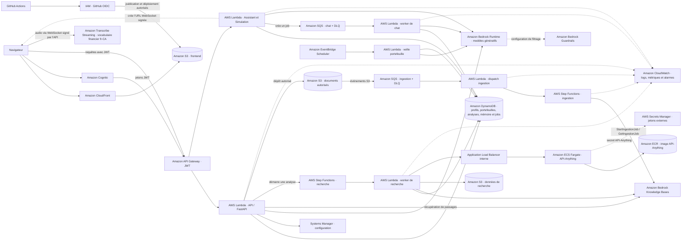

# InvestorOS

InvestorOS est une plateforme d’aide à la décision d’investissement créée pour le Datathon Polyfinance 2026. Elle permet d’explorer des profils et portefeuilles fictifs, de comparer des actifs, d’examiner des risques et de construire des scénarios conditionnels. Les analyses distinguent les données, les hypothèses et leurs limites. La plateforme n’exécute aucune transaction et ne fournit pas de conseil financier personnalisé.

## Lancer en local

Prérequis : Node.js 24, npm et Python 3.12.

```bash
npm ci
npm run dev:local
```

La commande démarre le frontend et l’API locale; ouvrir l’URL Vite affichée dans le terminal. Pour le frontend seul : `npm run dev:web`. Les appels aux fonctions AWS depuis l’API locale nécessitent des identifiants AWS côté serveur; aucun secret ne doit être placé dans le navigateur.

## Préparer et appliquer Terraform

La stack Assistant/Simulation possède son propre état Terraform. Il faut `uv`, Terraform 1.9 ou ultérieur, un profil AWS SSO autorisé pour le compte de développement et l’accès aux states S3 requis.

```bash
# Remplacer par le nom d’un profil SSO déjà configuré
export AWS_PROFILE=mon-profil-sso
aws sso login --profile "$AWS_PROFILE"

# Depuis la racine du dépôt
uv python install 3.12
./scripts/build-api.sh
cd infrastructure/terraform/environments/assistant-simulation
terraform init -reconfigure
terraform workspace show
terraform plan -out=/tmp/investoros-assistant-simulation.tfplan
terraform show /tmp/investoros-assistant-simulation.tfplan
```

Le script `build-api.sh` a besoin des fichiers locaux `assets_universe.csv`, `prices_daily.csv` et `corporate_actions.csv` sous `docs/prep/sources/Datathon2026/alphaforge_starter/`; ces données ne sont pas incluses dans Git. Après revue du plan — compte/région, créations, modifications, suppressions et remplacements — appliquer uniquement le plan approuvé :

```bash
terraform apply /tmp/investoros-assistant-simulation.tfplan
```

`terraform plan` ne modifie pas AWS; `apply` modifie l’infrastructure et peut entraîner des frais. L’environnement `dev` utilise une autre stack et un autre état. Lire le README de l’environnement concerné avant toute application : [Assistant/Simulation](../../infrastructure/terraform/environments/assistant-simulation/README.md) · [dev](../../infrastructure/terraform/environments/dev/README.md).

## Structure du dépôt

- `apps/web` — interface React, TypeScript et Vite.
- `apps/api` — API Python/FastAPI, intégrations AWS et logique produit.
- `services/workflows` — définitions Step Functions pour les analyses.
- `infrastructure/terraform/environments` — stacks AWS par environnement.
- `infrastructure/terraform/modules` — modules Terraform réutilisables.
- `agent-skills` — instructions et contrats des agents.
- `data` — contrats et outils; les jeux locaux/privés ne sont pas versionnés.
- `scripts` — démarrage local, construction du paquet Lambda et outils de développement.

## Architecture AWS



**Services IA :** Bedrock Runtime exécute les modèles de conversation et d’analyse; le Guardrail actif est appliqué aux appels concernés; Bedrock Knowledge Bases récupère les passages documentaires et reçoit les documents indexés. Le parcours de chat n’utilise pas encore les passages de la Knowledge Base comme contexte de réponse. Amazon Transcribe Streaming reçoit la dictée vocale en français canadien directement depuis le navigateur, via une URL WebSocket temporaire signée par l’API et un vocabulaire financier dédié.

Le diagramme représente les flux prévus par le code et les stacks Terraform; les flèches pointillées désignent des liens de configuration ou d’observabilité. La présence dans Terraform ne prouve pas qu’une ressource est déployée ou vérifiée de bout en bout. Consulter le README de chaque stack pour son état et ses limites actuels. Les alarmes CloudWatch n’ont pas nécessairement de destination de notification configurée.
